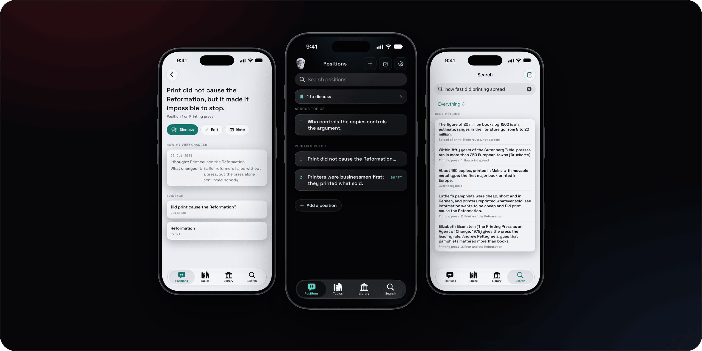
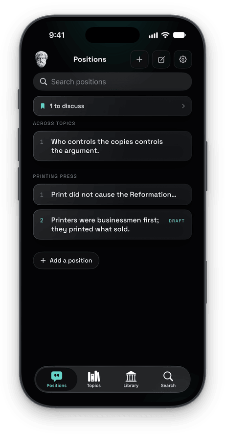
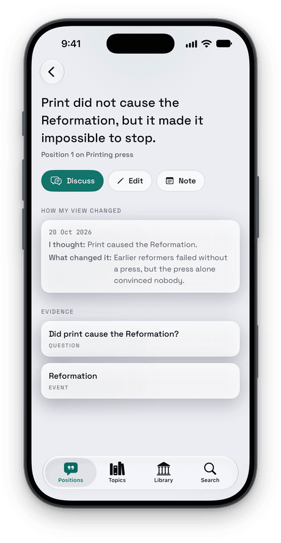
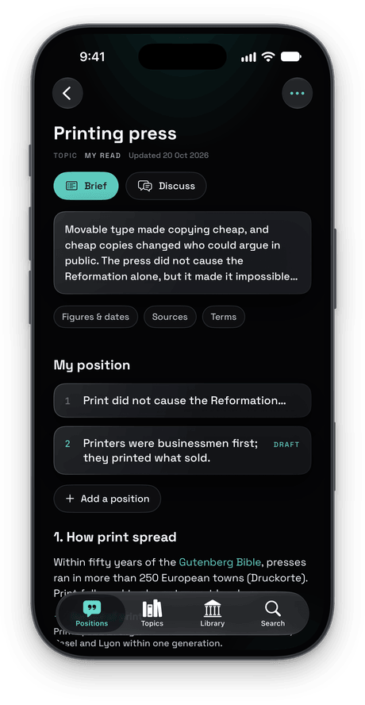
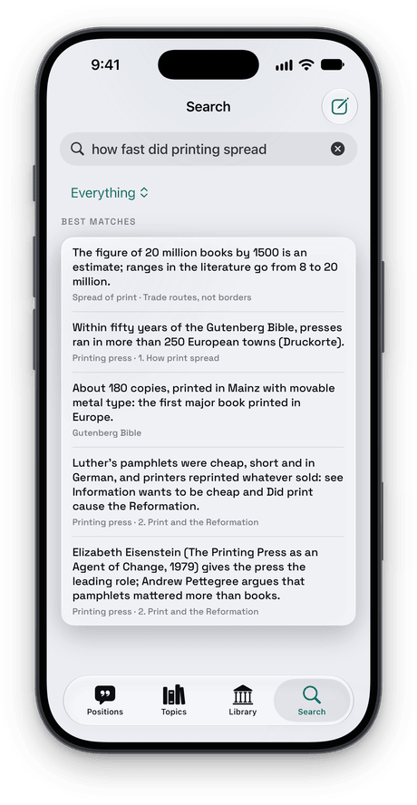

<p align="center">
  
</p>

# Arestoteles

A personal knowledge map on the phone. This is the server behind the Arestoteles iPhone app: it reads an Obsidian vault
of topics, positions, mechanisms, events and questions, keeps it indexed, searches it by meaning and applies the app's
edits by the vault's own rules.

[The app](https://patrikbreeck.com/en/apps/#arestoteles) · [Its code](https://github.com/Ares-Empire/empire-ios) ·
[The API](docs/API.md)

## What it does

- **Indexes the vault.** Notes with each block's place in the source, positions with the history of how a view
  changed, links and backlinks, a glossary, and a brief per topic.
- **Edits by the vault's rules.** Rewording a position, a quick note into the Inbox, a mark to discuss something later.
  Each edit is checked with the vault's own check, then committed and pushed. A failing check undoes it.
- **Searches by meaning.** A question in German finds the English passage. A small embedding model
  (EmbeddingGemma, 4-bit) runs on the CPU through ONNX Runtime, so nothing is generated: every result is a passage as it
  stands.
- **Stays in sync.** The vault is pulled every minute and compatible app commits are replayed on top. Pending work
  that conflicts is kept on a recovery branch and reported unhealthy until reconciled. Edits check supplied
  note versions; enforcement becomes mandatory after the staged client rollout. Interrupted writes recover from a
  journal. See the [edit-safety audit](docs/225-edit-safety.md).

## Screenshots

On the made-up vault in `tests/fixtures/vault/`:

<table>
  <tr>
    <td></td>
    <td></td>
    <td></td>
    <td></td>
  </tr>
</table>

## How it's built

- Python with FastAPI and uvicorn, one process: the API and the sync loop.
- markdown-it-py reads the notes; the vault's own `check.rb` decides whether an edit is valid.
- ONNX Runtime and tokenizers for the meaning search, with no PyTorch.
- The iPhone app logs in with an Ares account ([ares-empire](https://github.com/Ares-Empire/ares-empire)), and the API
  admits only the vault's owner.

The repository also holds the website arestoteles.de (`web/`, `webauth/`), a private portal behind its own login.

## Run it

```sh
python3 -m venv .venv && .venv/bin/pip install -e '.[dev]'
.venv/bin/python -m pytest -q                                   # needs git and ruby
# against a copy of a vault, without pulling or pushing:
ARESTOTELES_VAULT=/tmp/vault-copy ARESTOTELES_PULL=0 ARESTOTELES_PUSH=0 EMPIRE_ALLOWED_USERS=<your user id> \
  .venv/bin/python -m arestoteles
curl -s http://127.0.0.1:8099/api/arestoteles/health
```

`.venv/bin/python -m arestoteles.meaning fetch --dir models` downloads the meaning model. Without it, search answers by
words only. Deploying: [deploy/README.md](deploy/README.md). The layout and the rules: [CLAUDE.md](CLAUDE.md).

| File | What it is |
|---|---|
| `docs/API.md` | The contract, with samples in `docs/samples/`. |
| `tests/fixtures/vault/` | A small made-up vault; it builds exactly `docs/samples/vault.json`. |
| `scripts/search_eval.py` | Compares meaning models for the search. |
